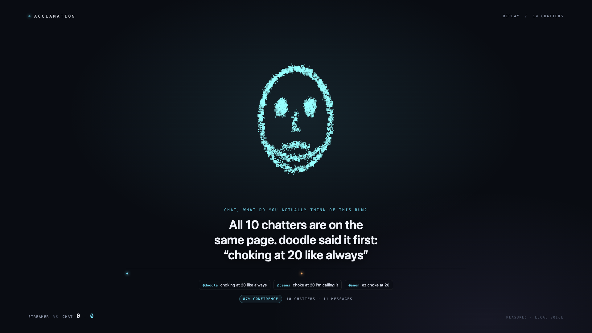
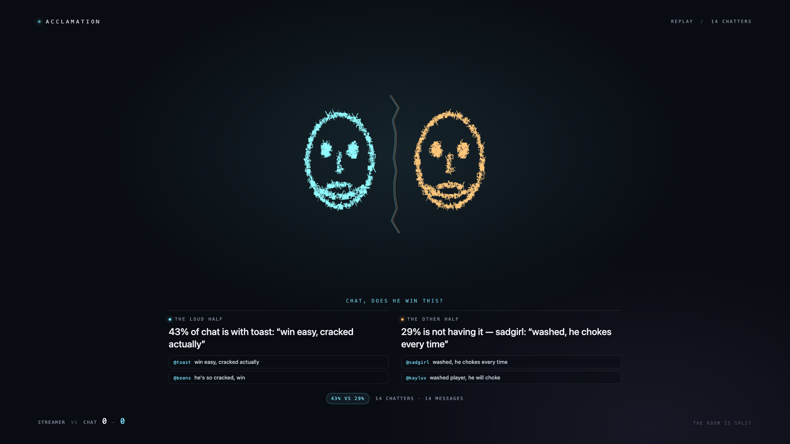
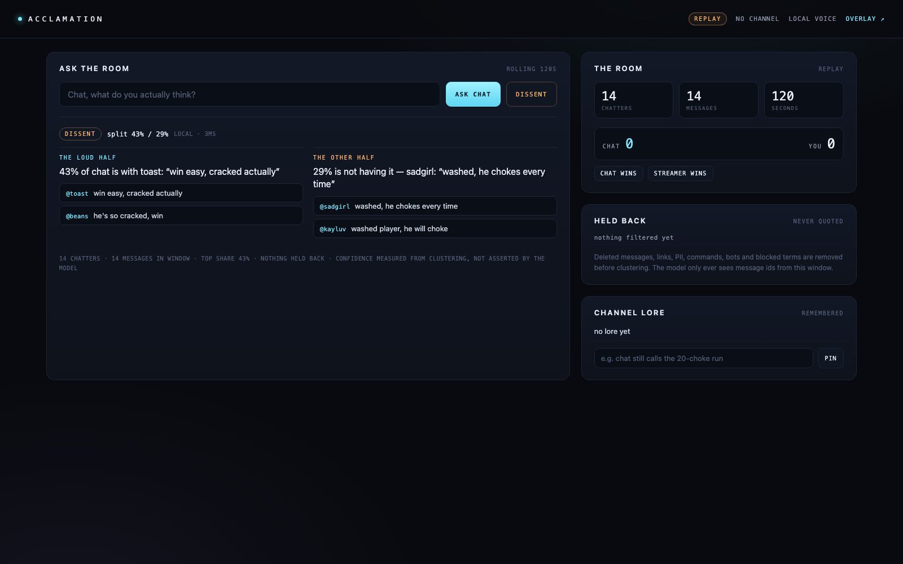

# Acclamation

**Your chat has a word. Now it has a voice.**

Every stream has a chat. None of them have a face. Acclamation turns a rolling
window of real Twitch chat into **one character** the streamer can interrogate:
it measures what the room actually thinks, answers out loud, and quotes real
chatters as receipts. When the room is split, the face fractures and two voices
argue with each other.

> Built for the **Codex × TwitchCon Hackathon** (2026). Twitch-native, live-only,
> and load-bearing on the model: remove the AI and the product stops existing.



<p align="center"><em>One stance, measured at 87% confidence, quoting the chatters who decided it.</em></p>



<p align="center"><em>Split mode: two faces, two voices, two colours. 43% vs 29%.</em></p>



<p align="center"><em>The control room: ask the room, force a dissent, pin lore, and see exactly what was held back.</em></p>

---

## Why this is not a chatbot

The obvious build is "AI replies to each chat message." Acclamation does the
opposite: it collapses a thousand chatters into a single entity that the
streamer can *talk back to*.

| What you get | Why it needs a model |
| --- | --- |
| A stance in one voice, in the room's own register | Summarising hundreds of short, contradictory messages |
| Receipts — real usernames and quotes | Selecting representative messages, then grounding them |
| Split mode — two voices that argue | Detecting and voicing two opposing readings of the same window |
| Confidence | Measured from clustering (see below), not from the model |
| Memory and a Streamer-vs-Chat record | Persistent lore, calls and outcomes |

The model is not decoration: it writes the voice and the argument. But it never
gets to invent a quote, a username or a number.

## Three mechanics

1. **Consensus.** Ask "Chat, what do you actually think?" The face forms and
   answers with a measured confidence and 2–5 receipts. Every receipt is a
   message id from the window, resolved locally — the model only picks ids.
2. **Dissent.** When no stance clears ~62% and the runner-up holds ≥25%, the
   face splits into two. Two voices, two colours, two receipt sets. Streamers
   can also force it from the dashboard.
3. **Memory.** Pinned lore ("chat still calls the 20-choke run") is injected
   into the prompt; every call is stored, and the Streamer-vs-Chat scoreboard
   survives restarts.

## Quickstart — offline, in about 60 seconds

Requires **Node 22.19+**. There are no dependencies to install (the runtime is
Node's built-in WebSocket, HTTP and SQLite).

```bash
npm test                                  # 83 tests, no network
npm run replay                            # consensus fixture through the whole pipeline
npm run replay -- --fixture replay/fixtures/dissent.jsonl
npm run replay -- --fixture replay/fixtures/messy.jsonl
```

The replay harness is a **fake EventSub WebSocket server**: the real client
connects to it, the real scrubber/window/clusterer/validator run, and the answer
is printed with its receipts and held-back counts. No Twitch account and no API
key are needed.

To see it:

```bash
npm run replay -- --serve
# dashboard  http://127.0.0.1:8787
# overlay    http://127.0.0.1:8787/overlay?stage=1
```

Or run the server without Twitch (sample mode, empty room, honest banner):

```bash
npm start
```

### With a model

Set `LLM_API_KEY` (and optionally `LLM_BASE_URL` / `LLM_MODEL`) in `.env`.
Any OpenAI-compatible `/chat/completions` endpoint works. Without a key the
**local voice** composes the answer from the measured clusters — useful for
building, and a real fallback if the model times out during the demo.

Semantic clustering is opt-in: set `ACCLAMATION_EMBEDDINGS=openai` and
`LLM_API_KEY` to cluster with embeddings. `EMBEDDINGS_MODEL` defaults to
`text-embedding-3-small`; the existing `LLM_BASE_URL` selects the endpoint.
Without a key, or if the embedding request fails, clustering falls back to the
local lexical method. The network-free tests use deterministic fake embeddings.

## Live setup

1. **Create the Twitch app** at <https://dev.twitch.tv/console/apps>.
   OAuth Redirect URL: `http://localhost:8917/callback`.
2. **Configure.**
   ```bash
   cp .env.example .env
   # TWITCH_CLIENT_ID=...
   # TWITCH_CLIENT_SECRET=...
   # TWITCH_CHANNEL=your_channel_login
   ```
3. **Authorize once.**
   ```bash
   npm run auth
   ```
   Requests `user:read:chat channel:read:subscriptions channel:moderate`;
   the last two scopes are optional. Writes `.tokens.json` with mode 600. The
   token must belong to the channel being read.
4. **Prove the live leg before building anything else.**
   ```bash
   npm run doctor
   ```
   Validates the token and scopes, resolves the channel, opens the real EventSub
   socket, creates the subscriptions, and waits for one actual chat message.
   It exits 0 and prints the message when the live leg works.
5. **Run.**
   ```bash
   npm start
   ```
   Dashboard: `http://127.0.0.1:8787`. Overlay for OBS:
   `http://127.0.0.1:8787/overlay` (1920×1080, transparent background,
   "Shutdown source when not visible" off, audio via the browser source).

### Triggering

- Dashboard: type a question, **Ask chat** (or **Dissent**).
- Anything that can POST:
  ```bash
  curl -X POST localhost:8787/api/trigger \
    -H 'content-type: application/json' \
    -d '{"question":"Chat, what do you actually think of this run?"}'
  ```
  Pass `"mode":"dissent"` to force the split. Stream Deck's "HTTP request"
  action works out of the box.

## How confidence is measured

Clustering turns the window into stances. The confidence is the share of
**unique chatters** in the leading stance, shrunk toward 50% for small samples:

```
reliability = 1 − e^(−chatters / 12)
confidence  = 50 + (share·100 − 50) · reliability
              + (share − runnerUpShare) · 15 · reliability
```

Nine chatters where 100% agree reports ~84%, not 100%, because nine people is
not the internet. A 43/29 split reports both shares and a measured confidence.
Under `MIN_CHATTERS` (default 4) it refuses to speak at all: *"Only 3 people
have said anything. That is not a crowd yet."*

The model is not allowed to return a confidence field; the contract rejects it.
That number is computed from the window and attached by the session.

## Safety, the part judges poke

| Rule | Mechanism | Test |
| --- | --- | --- |
| Never quote a deleted message | `channel.chat.message_delete` scrubs immediately; deleted ids cannot be re-added | `test/window.test.js`, `test/session.test.js`, `test/replay.test.js` |
| Never quote a timed-out or banned user's scrubbed messages | With `channel:moderate`, a ban/timeout event removes the user's messages and blocks new ones; an unban permits fresh messages | `test/window.test.js`, `test/session.test.js` |
| Never quote links or PII | intake scrubber drops links, emails, phone numbers | `test/scrub.test.js` |
| Never quote commands, bots, blocked terms, floods | intake scrubber + per-user cap + dedupe | `test/scrub.test.js`, `test/window.test.js` |
| Never invent a quote or username | receipts are ids; the contract resolves them to real messages | `test/contract.test.js`, `test/session.test.js` |
| Never fake agreement | dissent/unclear/refusal modes are measured; the model must match the measured mode | `test/cluster.test.js`, `test/contract.test.js` |
| No chatbot-policy risk | audio comes from the overlay; Acclamation never posts to chat | by construction |

Metrics for all of this are exposed in the dashboard's **Held back** panel and
in `answer.basis.filtered` — the receipts for the receipts.
An answer already in flight can still use the snapshot taken before a deletion
or ban; the next trigger uses the scrubbed window. See [safety notes](docs/SAFETY.md).

## Architecture

```
OAuth (npm run auth) ──► .tokens.json
                                │
EventSub WebSocket ──► ChatWindow ──► clusters ──► prompt ──► OpenAI-compatible
 channel.chat.message     scrub      measure      ids only        │
 channel.chat.message_delete  │        │                          ▼
 channel.raid / subscribe     │        │                   strict JSON contract
 channel.ban / unban          │        │                          │
                              │        │                    + grounding check
                              ▼        ▼                          │
                        SSE /api/events ──► overlay: glyphs,        │
                                            face, receipts,       ▼
                                            voice          SQLite lore/calls/
                                                           scoreboard
```

- **Listen:** `wss://eventsub.wss.twitch.tv/ws`, protocol v1, with reconnect and
  keepalive-watchdog handling (`src/eventsub/client.js`).
- **Ask:** on demand only. No always-on model chatter; cost is one small JSON
  call per trigger.
- **Speak:** the overlay. Browser voice by default; `/api/tts` proxies an
  OpenAI-compatible speech endpoint when `TTS_PROVIDER=openai`.
- **Persist:** `node:sqlite` (with an in-memory fallback) for lore, calls and
  the scoreboard.

## What is verified, and what is not

| Claim | Status |
| --- | --- |
| 83 tests, no network, no API key | ✅ `npm test` |
| Runs on Node 22.19 (minimum) through Node 25 | ✅ full suite executed on 22.19 and 25; CI matrix covers 22.19 + 24 |
| Real EventSub client against a real WebSocket implementation (fake server) | ✅ `test/eventsub.test.js` |
| Reconnect + keepalive-watchdog paths | ✅ tested at sub-second keepalives |
| Full pipeline through replay fixtures, including delete-scrubbing | ✅ `test/replay.test.js` |
| Embedding clustering and lexical fallback | ✅ deterministic fake embeddings in `test/cluster.test.js`, `test/embeddings.test.js`; no live provider required |
| Ban/unban subscription shapes and window scrubbing | ✅ `test/helix.test.js`, `test/window.test.js`, `test/session.test.js` |
| Overlay renders consensus and dissent faces at 1920×1080 | ✅ existing screenshots (`docs/overlay-consensus.png`, `docs/overlay-dissent.png`); 1280×720 recheck pending |
| Grounding rejects invented ids and URLs; falls back to the local voice | ✅ `test/contract.test.js`, `test/session.test.js` |
| Helix subscription bodies and conditions (the live leg's request shapes) | ✅ `test/helix.test.js` with a stubbed Twitch API |
| Live Twitch leg (real token, real channel, real message) | ⏳ **not run in this environment** — credentials were not available. `npm run doctor` is the gate and exits 0 only after a real message arrives. |
| Model wording quality | ⏳ the local voice is exercised in tests; a real model run needs `LLM_API_KEY` |
| TTS on stage | ⏳ browser playback and `?mute=1` still need a runtime check on the machine that will stream |

This is deliberate: the repo does not claim a live run it has not done. The
doctor command exists so the first hour of day one ends with real chat arriving
over the socket, exactly as the plan said.
See [verification evidence](docs/VERIFICATION.md) for the recorded checks and
remaining manual checks.

## Repo map

```
AGENTS.md                 invariants, protocol details, latency budget, roadmap
src/chat/                 scrubber, rolling window, clustering + confidence
src/llm/                  prompt, strict JSON contract, provider, local voice
src/core/session.js       the orchestrator
src/eventsub/             WebSocket client + Helix subscriptions
src/memory/store.js       SQLite lore / calls / scoreboard
src/server/               HTTP API, SSE, static serving, live wiring
overlay/                  canvas glyph swarm (the face), HUD, voice
web/                      control-room dashboard
replay/                   fake EventSub server + JSONL fixtures
scripts/                  OAuth and the live doctor
docs/                     demo script, safety notes, submission copy, screenshots
test/                     83 tests
```

## Demo

The 3-minute run-of-show is in [docs/DEMO.md](../docs/DEMO.md): cold open, ask,
dissent, raid, memory, Codex, repo. The 20-second version: replay the dissent
fixture, open the overlay, press **Dissent**.

## License

MIT — see [LICENSE](LICENSE).
